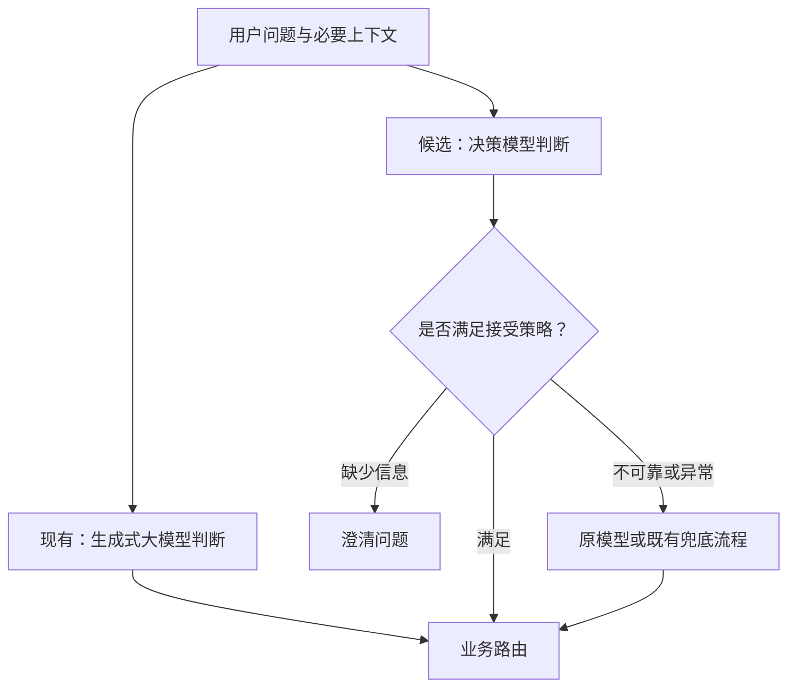
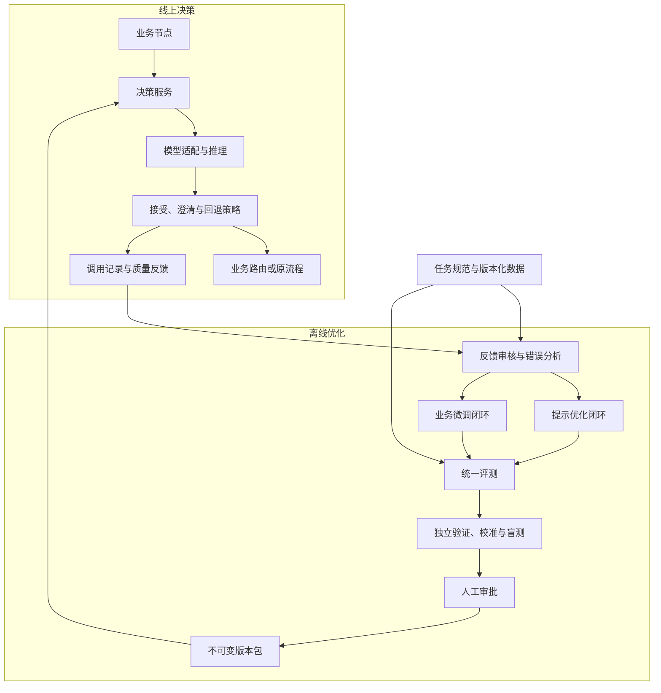
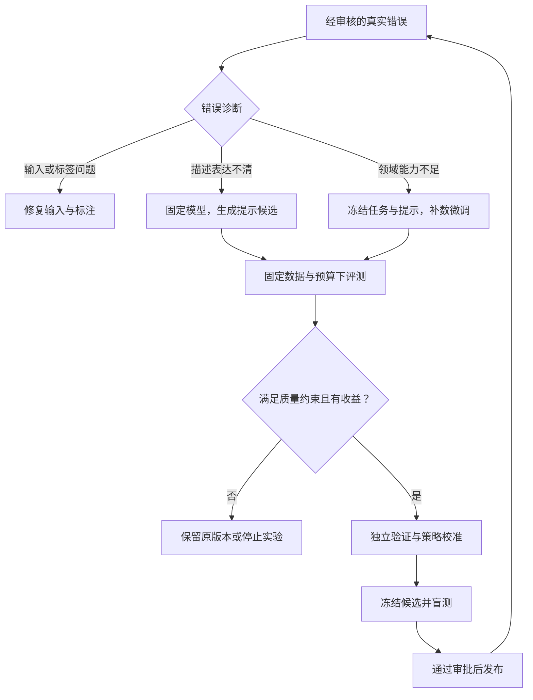

# 业务决策节点轻量化与双闭环 RSI 自优化方案

## 一、背景与目标

智能助理的一条业务链路，往往需要先识别用户意图，再判断是否改写问题、检索材料是否有用，最后生成回答。其中不少节点只需输出一个类别、是非结果或分数，却仍调用通用生成式大模型。

例如，用户问“退款已经申请了，怎么还没到账？”，意图识别节点只需要返回“退款进度查询”。当这类判断频繁出现或多个节点串联时，推理费用与等待时间会不断累积。与此同时，类别描述和提示词主要靠人工调整，业务错误尚未形成统一的优化反馈。

本方案将适合的判断节点交给决策模型处理，并建立提示优化、业务微调两条离线闭环。目标是在业务质量达标的前提下，降低完整任务的总成本与时延，同时形成可复用的节点优化能力。

项目围绕“用决策推理替代生成式判断、减少不必要的生成调用、减少回答模型的冗余输入”三条路径开展优化；通过双闭环 RSI 持续改善决策模型的业务适配能力，形成可对照、可验证、可回退的降本提速方案。

## 二、具体使用场景

### 2.1 主场景：智能助理意图识别

用户问题进入智能助理后，系统需要识别其业务诉求，再进入退款查询、商户结算查询等对应流程。决策模型承接的是路由前的判断，不负责查询业务数据，也不直接执行业务操作。

| 用户表达示例 | 期望识别结果 | 后续处理 |
| --- | --- | --- |
| “退款已经申请了，怎么还没到账？” | 退款进度查询 | 进入退款查询流程 |
| “今天的收款为什么还没结算？” | 商户结算查询 | 进入结算查询流程 |
| “这笔订单到底付成功没有？” | 支付状态查询 | 进入支付状态查询流程 |
| 前文说“我申请了退款”，当前问“什么时候到？” | 结合前文识别退款进度查询 | 使用必要的对话上下文 |
| 没有前文，只问“什么时候到？” | 信息不足，需要澄清 | 询问所指业务 |
| 问题明确，但不属于支持范围 | 未知意图 | 转原有兜底流程 |

“退款到账”与“结算到账”都有到账概念，但业务对象不同，是需要重点验证的混淆边界。多意图输入也应明确采用多标签、逐项判断或澄清，不能强行套用单选分类。

输入：当前用户问题、分类必需的对话上下文、经授权的结构化信息。
输出：类别 ID、各选项原始概率/分数、接受/回退状态、版本与耗时。

| 类别 | 固定业务定义 | 易混淆边界 |
| --- | --- | --- |
| refund_status | 已发起消费者退款后的进度或到账查询 | 不含商户交易资金结算 |
| settlement_status | 商户交易资金结算到指定账户的进度 | 不含消费者退款 |
| payment_status | 消费者订单支付状态查询 | 不等于退款进度 |
| unknown | 信息清晰但不属于已支持类别 | 区别于信息不足 |
| needs_clarification | 缺少必要指代或上下文，无法可靠分类 | 不强行归入最相似类别 |

提示优化应更清晰表达这种差异，而非把任一类别扩展成"所有到账问题"来提高局部分数。

**替换前后链路：**

图中两条路径用于比较现有与候选方案；正式运行时按批准配置选择路径。候选方案需验证完整路由结果，不能只展示模型返回的类别。

**场景应用举例（原本如何 → 用本方案预期如何）**

以"退款已经申请了，怎么还没到账？"为例：

| 环节 | 原本流程 | 用本方案后（预期） |
| --- | --- | --- |
| 判断方式 | 调用通用生成式大模型，让模型输出类别名称 | 调用轻量决策模型，直接输出类别 ID 与各选项概率 |
| 耗时 | 生成式推理串联，等待首 token 与完整文本 | 采用支持分类或选项打分的后端，预期减少生成式解码开销，实际时延待测 |
| 成本 | 生成式调用按实际输入、输出及计费规则核算，高频调用累积成本高 | 按所选后端的实际计费或部署成本核算，验证单次决策费用是否下降 |
| 易混淆处理 | 依赖人工调整提示词区分"退款到账"与"结算到账"，调整滞后 | 提示词 RSI 自动迭代类别描述，经评测后发布优化版本 |
| 未知/澄清 | 低置信时往往仍由大模型"硬猜"一个类别 | 置信不足时进入 CLARIFY 或 FALLBACK，回到原流程，不强行归类 |

### 2.2 扩展场景：是否需要问题改写

在多轮问答中，用户说“那什么时候到？”，系统可能需要结合前文补全为“已申请的退款预计什么时候到账？”，再进行检索。

决策模型只判断是否进入改写路径；需要改写时，仍由生成模型产出新问题。对于已经完整明确的问题，可直接检索，减少不必要的生成调用。

该场景的价值取决于检索和回答是否改善。漏掉必要改写可能损害召回，多做改写会增加成本，因此不能单纯追求降低改写率。

评测同时比较原始与改写后检索的关键证据和最终回答质量，依据漏改写的质量损失与多改写的额外费用设定策略。

**场景应用举例**

以多轮对话中"那笔呢？"（指代前文某笔交易）为例：

| 环节 | 原本流程 | 用本方案后（预期） |
| --- | --- | --- |
| 改写触发 | 在默认改写的流程中，每条问题都送生成式大模型改写，再检索 | 决策模型先判断是否需要改写，确认无需改写的完整问题直接检索 |
| 成本 | 每次调用都付出改写生成费用，包括无需改写的简单问题 | 仅需改写的问题才调用大模型，预期改写调用占比下降、总成本降低 |
| 风险 | 无统一评测，漏改写与多改写都靠人工经验权衡 | 用"必要改写召回 / 多余改写率"量化，按质量损失与额外费用设定阈值 |
| 回退 | 判定不需要改写但实际检索失败时无机制 | 判错可经反馈回流进入错误分析池，驱动提示或策略迭代 |

### 2.3 扩展场景：RAG 检索片段筛选

检索返回多段退款规则、商户结算说明和产品材料后，决策模型判断哪些片段对当前问题有帮助，再交给回答模型。

沿用已有分块与检索，先做"是否对回答有帮助"。

输入应包含问题、片段及必要来源和上下文；关键证据、例外条款和冲突材料需保守保留。主题相关不等于能支撑答案，更不等于答案正确。

此场景应与已有 reranker 对照。如果专用 reranker 在同等条件下更好、更便宜，就保留它。项目不要求所有节点都使用同一类模型。

**场景应用举例**

以用户问"退款多久到账"，检索返回 5 个候选片段为例：

| 环节 | 原本流程 | 用本方案后（预期） |
| --- | --- | --- |
| 片段筛选 | 5 个片段全部送入生成式大模型上下文，由模型自行取舍 | 决策模型先标注"是否对回答有帮助"，仅保留关键证据片段 |
| 上下文成本 | 冗余片段增加输入 token，推高生成费用与时延 | 裁剪后输入缩短，预期减少回答模型输入费用；完整链路时延需扣除筛选开销后验证 |
| 关键证据 | 例外条款、冲突信息可能被模型忽略 | 保守保留例外与冲突片段，减少漏答风险 |
| 对照 | 无独立评测，无法判断裁剪是否损害质量 | 用"证据召回 / 误删 / 保留比例"量化，与现有 reranker 公平对照后择优 |

## 三、降本提速机制与预期成效

### 3.1 三条降本提速路径

本项目不以减少必要的业务处理换取成本下降，而是将“需要生成内容”与“只需作出判断”的任务分开。以下收益均以业务质量达标为前提；原有调用方式和费用应先通过实际日志确认，不将示例流程直接视为现网事实。

| 优化路径 | 原有资源消耗 | 本方案如何减少消耗 | 提速来源与生效条件 |
| --- | --- | --- | --- |
| 替换昂贵判断 | 为获取一个类别或是非结果，调用通用生成式大模型 | 对适合的节点采用分类或选项打分后端，直接返回结构化决策，替代原生成式判断调用 | 减少生成式解码及相关处理；只有候选后端的实际推理、部署和回退开销更低时才有净收益 |
| 减少生成调用 | 默认改写流程对无需改写的问题也执行一次生成 | 先判断是否需要改写，明确完整的问题跳过改写生成，必要改写仍保留 | 无需改写的请求少等待一次生成；节省必须覆盖新增判断开销，且不能损害必要改写的召回 |
| 缩短生成输入 | 冗余检索片段进入回答模型，增加输入 token | 筛选与问题有关且能支撑回答的证据，保留必要的例外和冲突材料，减少冗余上下文 | 降低输入处理量及相应费用；筛选本身也消耗资源，实际净时延受后端、批处理和缓存影响 |

三条路径可以独立采用，不要求同时替换所有节点。输出更短不等于模型一定更小或更快；若所选后端仍需生成文本，则应按实际生成过程核算，不将其视为无生成开销的分类器。

### 3.2 同一业务问题的使用前后对比

以“退款已经申请了，怎么还没到账？”为例，演示一条包含意图识别、问题改写、规则检索和回答生成的链路。假设原流程分别调用生成模型完成意图识别、默认改写和最终回答，并将检索返回的 5 个片段全部送入回答模型。实际业务查询等其他必要步骤保持不变。

**以下数字仅用于说明链路变化，不是实测结果，也不是对现网调用次数的确认。**

| 环节 | 使用前：示例基线 | 使用后：预期路径 |
| --- | --- | --- |
| 意图识别 | 1 次生成式调用，输出退款进度查询类别 | 决策模型判断；满足接受策略后进入同一业务流程，不再执行原生成式分类调用 |
| 问题改写 | 1 次生成式调用，对问题进行改写 | 决策模型确认问题已完整明确后跳过改写；需要改写时仍调用生成模型 |
| 检索上下文 | 5 个检索片段全部进入回答模型 | 假设经评估其中 3 个已覆盖必要证据，则保留这 3 个；证据不足时不得机械裁剪 |
| 回答生成 | 1 次生成式调用，读取全部候选片段 | 仍保留 1 次回答生成调用，读取筛选后的证据 |
| 调用结构 | 共 3 次生成式调用 | 在判断可靠且无需改写的示例路径中，变为 1 次生成式调用，另增加决策与筛选开销 |

这一示例体现的是：**保留必要的回答生成，把用于判断的生成调用替换掉，把不必要的改写调用省下来，把冗余证据输入减下来。** 片段筛选的调用次数取决于后端与批处理方式，不假定多个片段可零开销或一次完成。

生成式调用从 3 次变为 1 次，不等于总费用或完整链路时延必然下降三分之二。问题需要改写、发生回退或筛选开销过大时，收益会缩小，甚至不成立；最终按完整任务的实际费用与时延判断。

### 3.3 双闭环 RSI 如何支持持续降本

仅替换模型可能因业务表达识别不准而增加误判、澄清和回退，抵消轻量化收益。双闭环 RSI 的作用，是在固定业务含义和质量约束下，持续改善低成本模型承接判断任务的能力，而不是在线上增加一轮自优化操作。

- **提示优化闭环**：针对“退款到账”与“结算到账”等混淆，优化类别描述、排除说明和示例，争取在不训练模型的情况下改善判断质量。
- **业务微调闭环**：当描述已清晰、输入与标签已修复，仍存在稳定的领域误判时，通过审核后的业务数据补强识别能力，并与未微调版本对照。

只有在接受部分错误率满足约束的前提下，提高自动接受覆盖率、减少不必要的回退才算有效改善，不能靠降低接受标准获得表面上的节省。两条闭环都在线下运行，候选通过评测和审批后才发布；标注、搜索、训练及验收费用按约定周期摊销，不能从收益核算中删除。

### 3.4 预期成效与参赛验证成果

项目预期实现“业务质量达标、完整任务成本下降、完整链路时延缩短”，并分别验证直接替换、提示优化和业务微调的贡献。当前文档未提供实测数据，以下为待验证目标，不作为已实现成果。

| 维度 | 使用前需记录的基线 | 使用后预期成效 | 验收关注点 |
| --- | --- | --- | --- |
| 业务质量 | 当前路由正确率、关键类别召回和最终回答质量 | 在预先约定的允许退化范围内达标，关键业务指标不突破下限 | 不以漏改写、误删证据或强行分类换取节省 |
| 完整任务成本 | 当前每成功任务总成本及费用构成 | 将新增决策、回退、部署运维与离线优化摊销一并计入后，成本仍下降 | 区分节点费用下降与完整任务净节省 |
| 响应效率 | 相同负载下的完整链路 p50/p95、吞吐和超时率 | 完整链路 p95 缩短，超时率不恶化，并报告其他性能指标 | 不能只用某个决策节点的加速代表用户整体体验 |
| 优化可持续性 | 当前模型、提示、数据与人工调整记录 | 形成可复现的提示优化与可选微调实验，发布可追溯、可回退的版本 | 无有效增量时保留原版本，不强行上线候选 |

成本降幅按“（基线每成功任务总成本－优化后每成功任务总成本）÷ 基线每成功任务总成本”计算；时延降幅按相同口径的完整链路 p95 比较。两者分别报告，不能用生成调用次数或输入 token 的降幅替代。具体质量门槛和验收目标在查看候选结果前确定，详细数据划分、测试条件及结果表见第六章。

参赛验证拟形成三类成果：可运行的首个意图识别试点、可复现的双闭环优化与对照实验、包含质量和完整成本时延的前后对比报告。扩展场景按实际验证进度分别呈现；未完成部分明确标注为计划或待验证，不与已完成成果混写。

## 四、总体架构

系统分为线上决策和离线优化两部分。线上只加载经过批准的版本，离线负责分析错误、生成候选并验证改进；两者通过版本包连接。

核心组件及其职责如下：

| 组件 | 主要职责 |
| --- | --- |
| 任务与数据管理 | 保存业务类别、输入要求、标注与数据划分，固定评测依据 |
| 决策服务与模型适配 | 接入候选模型，统一结构化结果，处理超时与后端差异 |
| 提示优化器 | 分析允许查看的错误，提出并比较提示候选 |
| 微调执行器 | 基于审核数据与固定模板运行训练实验 |
| 评测与版本管理 | 计算质量、成本和时延，记录血缘，管理发布与回退 |

这些组件可以先通过配置文件、批处理脚本、离线评测工具和轻量服务实现，不要求建设完整训练平台。候选模型可从 Kev、Laya、D3-Flash 等选择，中文效果、描述输入能力、训练支持和许可需逐一核实；规则与轻量分类器也应纳入对照。

线上调用只需提供任务标识和业务输入；类别描述、模型、阈值等由服务端版本包确定，避免调用方随意改变任务含义。

## 五、核心实现方案

### 5.1 业务节点如何替换

以意图识别为例，调用过程分为四步：

1. **准备输入**：提取当前问题和决定意图所需的前文，保留必要产品、渠道等授权信息。
2. **执行判断**：模型适配层将任务定义转为后端支持的格式，获取类别及原始分数。
3. **应用策略**：根据输入完整性、支持范围及校准后的接受条件，返回接受、澄清、回退或错误状态。
4. **记录结果**：关联请求、任务版本、模型/提示版本、输出、耗时、费用与回退原因，供评测和追踪。

不同模型的原始分数含义可能不同，应分别保留并校准，不能直接混用。模型给出较高分数，也不能保证输入属于支持范围或业务结果一定正确。

对“什么时候到？”这样的信息缺失，优先澄清；对超时、输入超限或不可靠结果，按策略回到原流程。决策与回退共用总截止时间，避免增加不可控等待。回退大模型的输出同样需要评测。

### 5.2 提示优化闭环如何运行

提示优化固定模型权重和业务类别含义，只调整判断指令、类别描述、包含/排除说明及允许的示例。

例如，初始类别描述为：

> 退款到账问题。

如果训练池中反复出现退款与商户结算混淆，优化器可以提出：

> 查询已发起的消费者退款何时到账或当前进度；不包含商户收款结算，也不包含尚未发起的退款申请。

实现时，优化器读取经审核的训练错误和混淆统计，提出少量候选，并说明改动与预期解决的问题。执行器检查类别集合、字段、长度和示例来源，再在固定开发集上比较初始版本、当前最优与新候选。

只有满足质量约束且产生有效收益的候选才被保留；连续无改善或达到调用费用、轮次、时间上限即停止。优化器不能修改类别定义、标签或评测程序，关键语义变化需人工审查。

该闭环仅适用于支持指令或类别描述输入的后端。固定标签分类头不能因为修改外部描述就自动获得能力提升。

### 5.3 业务微调闭环如何运行

微调解决的是模型对业务表达的稳定识别能力不足，不能代替输入修复和标签治理。

| 错误现象 | 优先处理 |
| --- | --- |
| 缺少前文，无法确定“到账”指什么 | 补充上下文或澄清 |
| 同类样本标注不一致、类别重叠 | 修正规范并仲裁标签 |
| 类别基本正确，但接受与回退不合理 | 校准分数和调整策略 |
| 描述已明确，仍稳定误判业务术语或口语 | 补充真实标注，比较微调 |
| 输入被截断或超过模型长度限制 | 调整输入方案或更换后端 |

进入微调后，先冻结任务与提示，按错误类型提出补数需求。新数据完成授权、脱敏、标注与去重后，使用批准的训练模板生成少量配置，在限定 GPU 时间和候选数量内执行。

训练方式以所选模型支持为准，可比较决策头、适配器或其他成熟微调方式，不假设所有后端都支持同一种 LoRA。除困难样本外，还需保留日常分布数据，防止局部提升伴随通用问题退化。

训练完成后，与未微调版本使用同样数据、输入和提示比较，并检查不同随机种子的稳定性。微调无收益则保留原版本，不强推训练产物。

### 5.4 两条闭环如何协同

初期先固定模型优化提示，再固定任务与入围提示比较微调。后续可以交替运行，但每次应明确主要改动，避免同时修改提示、训练数据和阈值，无法解释收益来源。

最后一条反馈边表示发布后继续采集业务反馈，须经审核才能进入下一轮；不表示模型会在线自动训练或直接改写生产配置。

### 5.5 评测、版本与运行保障

任务规范、数据、模型、提示、输入处理、校准与接受策略共同组成一个版本包。实验记录父版本、改进假设、配置、指标及费用；上线时整包切换，异常时整包回退。

最终候选通过离线验收后，先做不改变业务结果的影子验证，再经批准灰度。监控关键类别错误、接受覆盖率、回退率、超时、成本和输入分布变化；质量或运行指标触发预设条件时暂停新版本。

数据、训练、优化器和评测分别授权；训练只运行批准模板。业务语义变更与生产发布保留人审，决策结果不直接授权退款、资金操作或风控处置。

## 六、效果验证方案

### 6.1 验证要回答的问题

验证围绕三件事展开：基础替换是否值得，双闭环是否带来增量，加入回退后的完整业务链路是否仍有收益。

| 对照组 | 方案 | 主要验证内容 |
| --- | --- | --- |
| A | 当前生成式大模型与现有提示 | 现有质量、费用和时延 |
| B | 原始决策模型与初始描述 | 直接替换收益 |
| C | B + 提示优化 | 提示优化的增量 |
| D | 优化提示 + 业务微调 | 在 C 基础上是否进一步改善 |
| E | 入围候选 + 接受/澄清/回退策略 | 最终业务链路表现 |

A/B/C 为基础对照；D 在具备有效数据和训练条件时开展。若要单独归因微调贡献，可增加“初始描述 + 微调”消融组；也可让现有大模型获得同等提示优化预算，检验收益是否主要来自描述改进。

E 应评估经过开发/验证阶段选定的候选，不能在盲测中反复挑选冠军。所有方案使用相同业务语义和必要上下文。

### 6.2 测试数据如何准备

以真实、人工标注的业务问题为主，覆盖正常表达、易混淆类别、多轮指代、口语与错别字、未知意图、信息不足和多意图。类别不均衡时，同时保留真实分布集和困难集，分别报告。

训练/错误分析、搜索开发、独立验证、校准和最终盲测按用途隔离；同一会话、事件和近重复样本不能跨集合。优化器只查看允许的数据，盲测不用于生成候选或调阈值。

数据规模根据类别覆盖与要证明的差异确定，不预先用固定条数保证效果。可先用小批样本完善标注边界，再扩展独立评测；合成数据可辅助训练，不充当真实业务验收数据。

### 6.3 离线同题对照

对各组重放相同问题，记录预测结果、耗时和费用，并对错误按类别和场景拆分。

| 维度 | 核心指标 | 目的 |
| --- | --- | --- |
| 分类质量 | Accuracy、Macro-F1、各类召回/精确率 | 避免整体分数掩盖关键类别退化 |
| 接受策略 | 自动接受覆盖率、接受部分错误率 | 同时衡量“处理多少”和“处理得多可靠” |
| 性能 | p50/p95、吞吐、超时率 | 判断实际并发下是否提速 |
| 费用 | 单节点费用、完整任务费用 | 区分节点节省与总体节省 |

使用真实中文长度、类别数、设备和并发，区分冷启动与稳定运行；同时纳入现有模型的缓存和批处理条件。对质量差值报告合适的区间，按会话分组进行配对分析；较小提升需足够样本支撑，训练与推理随机性分别检查。

未知输入和关键业务错误单独观察，不能只筛选高置信度成功样本展示准确率。

### 6.4 完整业务链路验证

节点评测通过后，还要验证下游结果，防止“分类更便宜，业务反而变差”。

| 场景 | 下游验证方式 |
| --- | --- |
| 意图识别 | 检查最终路由正确率、误转、用户纠正和转人工情况 |
| 是否改写 | 比较原始与改写后检索的关键证据召回、回答质量及完整任务费用 |
| 片段筛选 | 检查关键证据是否误删、回答是否有依据和完整，并与现有 reranker 比较 |

先通过影子流量做同题比较，再按会话固定分组进行受控灰度。影子双跑的额外开销单列为实验费用。线上没有投诉不等于正确，应结合抽样审核及可信反馈评估。

### 6.5 成本口径与验收结论

成本至少包括决策推理、原流程回退、仍需执行的生成/检索，以及新增部署运维；标注、提示搜索、训练和验收费用按约定周期摊销。

**每成功任务总成本 = 全部任务总成本 ÷ 成功任务数。**

回退和失败任务的支出不能排除。分别报告试点规模与预期业务量下的成本；低流量时，自部署固定费用可能抵消推理节省。

建议最终用一张结果表呈现，实测前统一标记“待测”：

| 指标 | 当前大模型 | 原始决策模型 | 提示优化版 | 微调版（可选） | 最终策略 |
| --- | --- | --- | --- | --- | --- |
| 分类质量与区间 | 待测 | 待测 | 待测 | 待测 | 待测 |
| 关键类别召回 | 待测 | 待测 | 待测 | 待测 | 待测 |
| 自动接受覆盖率 / 错误率 | 按现有策略记录 | 待测 | 待测 | 待测 | 待测 |
| 每任务生成式调用次数（含回退） | 待测 | 待测 | 待测 | 待测 | 待测 |
| 回答模型每次调用输入 token（均值 / p95） | 待测 | 待测 | 待测 | 待测 | 待测 |
| 完整链路 p95 | 待测 | 待测 | 待测 | 待测 | 待测 |
| 每成功任务总成本 | 待测 | 待测 | 待测 | 待测 | 待测 |
| 回退率与费用 | 按现有策略记录 | 待测 | 待测 | 待测 | 待测 |

业务质量的允许退化范围、关键类别召回下限、覆盖率要求及 SLA 在看候选结果前确定。**先满足质量约束，再比较成本和时延。** 降本提速比例以实测为准，样本不足时仅报告试验观察，不宣称已证明生产收益。

## 七、预期价值与适用边界

本方案的价值有三个层面：通过适配判断任务的模型减少不必要的生成开销；用真实错误推动可验证的持续改进；复用任务定义、模型适配和评测能力，降低后续节点接入成本。

适合优先尝试的节点应具有明确输出、可获得可靠标签、稳定业务边界和足够调用量。开放式生成、复杂推理或缺乏必要上下文的任务，不宜仅靠分类替换。

项目创新重点不是单独使用提示优化或微调，而是把支付业务边界、双闭环优化、质量约束和完整成本核算连起来，形成从真实错误到可追溯发布版本的链路。

如果实测发现回退率过高、质量不达标或总成本无改善，应只替换有效节点、保留原模型，或停止相应优化。有效结论也可以是“提示优化有用，微调暂时无收益”。

**候选能力核查入口：** [Kev](https://github.com/jaredpalmer/kev)、[Laya 微调](https://github.com/NandhaKishorM/laya/blob/main/docs/finetune.md)、[D3-Flash](https://huggingface.co/vllm-sr/d3-flash)。链接沿用原稿，实施前重新核实版本、训练方式和许可。
